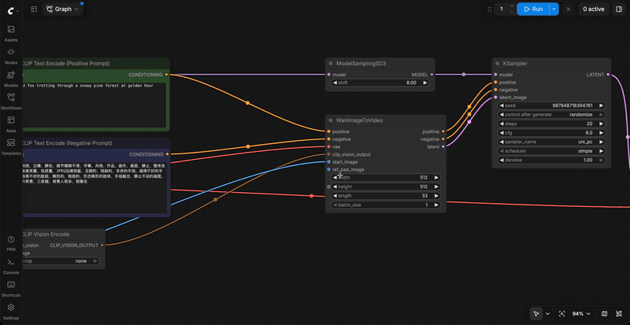

# Zip Ties for ComfyUI

A frontend extension that bundles wires into a ribbon with small zip ties. The idea comes from a [prototype by @cmzw_](https://x.com/cmzw_/status/2114315567977107653).



The full recording with the cut and removal gestures is [zip-ties-demo.mp4](zip-ties-demo.mp4).

## Use

| Action | Gesture |
|---|---|
| Tie wires together | Hold `Z` and drag a line across the wires |
| Move a tie | Drag the tie |
| Remove a tie | Hold `Z` and drag a line across the tie, or double-click it |

The wires keep their colours and run side by side between ties. Hovering or dragging a tie highlights every wire in it. A wire can pass through several ties. When a wire is deleted or reconnected, it leaves its ties, and a tie with no wires left disappears.

Ties are stored in the workflow's `extra.zipTies`, so they save, load and undo with the rest of the graph. Workflows opened without the extension still load; the wires draw normally.

## Install

Clone into `ComfyUI/custom_nodes` and restart ComfyUI:

```sh
cd ComfyUI/custom_nodes
git clone https://github.com/safzanpirani/comfyui-zip-ties
```

The extension adds no nodes and has no Python dependencies.

## How it works

The extension is one file, `web/zip_ties.js`. It wraps two litegraph methods on the canvas:

- `renderLink`: records where each wire starts and ends, and when a wire belongs to a tie it redraws the wire as several segments that pass through the tie, each strand offset sideways from the tie centre. Segment drawing is delegated to ComfyUI's own link renderer, so colours, borders and highlight behaviour come along for free.
- `drawConnections`: prunes ties whose wires are gone, then draws the tie bars on top of the wires.

The cut gesture runs in capture-phase listeners on `window`, so it sees pointer events before litegraph and can claim them when `Z` is held or a tie is hit. The cut tests the drag segment against each wire's bezier curve. When a new tie's wires all already belong to another tie, it copies that tie's strand order so wires never cross inside the bundle.

## Limits

- Wires that pass through native reroutes cannot be tied.
- The ribbon shape is tuned for spline links. Straight and linear link modes still route through the ties, but the cut test treats each segment as a straight line.
- Tested on ComfyUI 0.42.0 with frontend 1.57.1, in both the classic canvas and Vue nodes mode.

## License

MIT
